# Herd architecture

A single graph holding all of Herd would be a hairball nobody could
review, so this document is one top-level diagram that really is the whole
system, followed by one detail diagram per box of it, each complete in
itself. The cut is deliberate: nothing is left out, and a box in the
top-level picture always has a section below naming every part of it.

Reference, not a journal: it changes when the behaviour changes. Every
figure, name and arrow here is read out of the code of this commit, not
out of `docs/plan.md` — where the plan and the code disagree, the code is
drawn and the disagreement is a finding, not a diagram. Decision numbers
(`D…`) point at `docs/decisions.md`; expectation numbers (`E-…`) at
`docs/coverage.md`.

## The legend, used in every diagram below

Four classes and two kinds of arrow, the same in all of them.

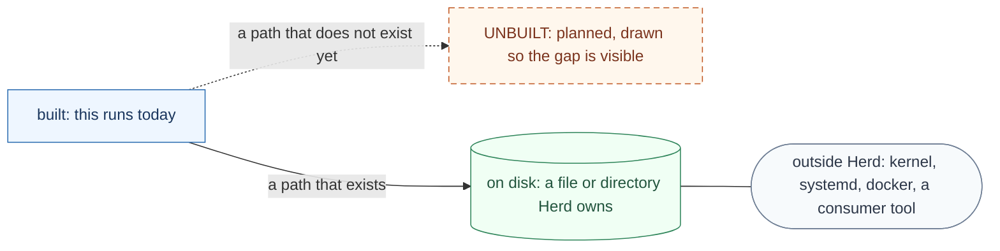

Anything in the unbuilt class also says so in its own label, so the
distinction survives a renderer that drops styling. Section 12 lists every
unbuilt thing in one place.

## 1. The whole system

Three kinds of process, one service, two state roots, one protocol crate
they all link. Every connection is dialled by the peer; the hub listens on
loopback only and nothing else in Herd listens at all (invariant 3, D4,
D14).

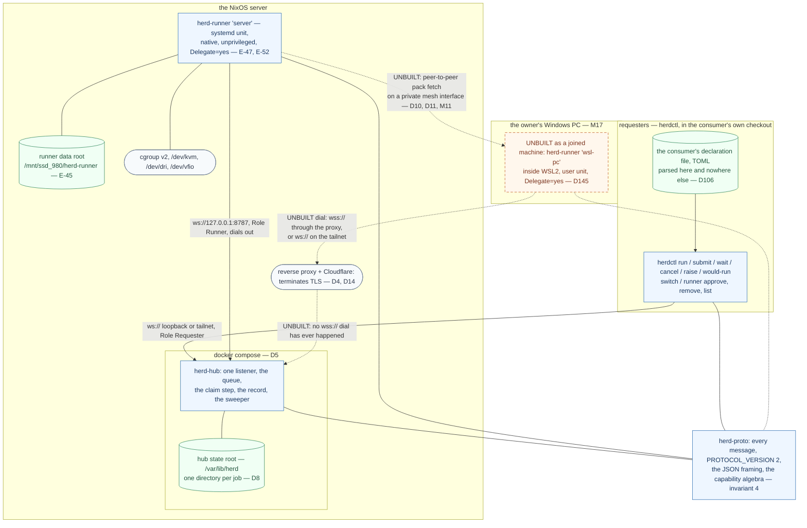

What the picture asserts, in words:

- **A requester never names a machine** (invariant 6). It says what to run;
  the hub decides where.
- **A runner dials out.** Nothing inbound is needed for a runner to work.
  The private-mesh fetch endpoint invariant 3 permits is not built.
- **The hub is never in the byte path between runners** (D10). It is in the
  byte path for a *record* — a log, a `results.json`, a screenshot — because
  that is read next by a requester and not by a job (D148).
- **Everything the hub knows is on its disk before it is acted on.** A
  result is acknowledged to the runner only once it is recorded, because
  until then the runner is the only copy (E-44, D19).

## 2. The four crates

`herd-proto` is a library and does no I/O. The other three are binaries
with a library beside them, which is what lets the end-to-end tests run a
real hub, a real runner and a real requester in one process. Every arrow
into `herd-proto` is a real dependency; every arrow between the other
three is a **dev-dependency only**, so no binary links another.

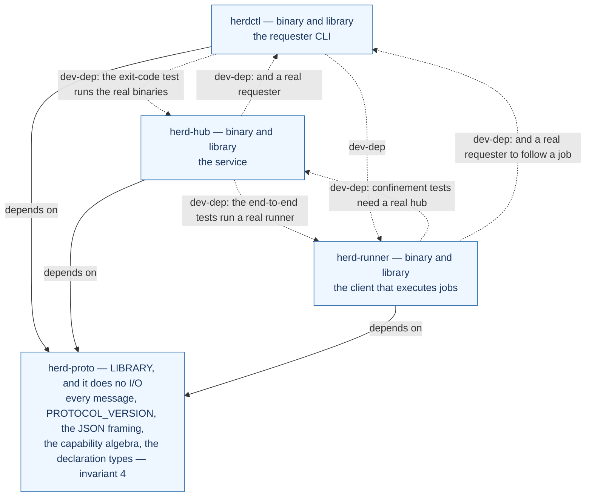

Every module, and what lives in it:

| Crate | Module | What is in it |
|---|---|---|
| herd-proto | `lib.rs` | `ToHub`, `FromHub`, `Asked`, `Role`, `Switch`, `Priority`, `JobOutcome`, `Cap`, `JobMetrics`, `Pressure`, `JobId`, `RunningJob`, `RunnerSwitch`, `ApprovedRunner`, `RunnerFacts`, `SuspendedCapability`, `PROTOCOL_VERSION`, `HEALTH_EVERY`, `STILL_THERE_EVERY`, `JOB_LOG_FRAME_BYTES`, `SILENCE_MARGIN`, `OUTPUT_FORMAT_VERSION`, `VERDICT_FORMAT_VERSION`, `version_gap`, every named refusal sentence |
| herd-proto | `capability.rs` | `LabelSet`, `Capability`, `CapabilityKind`, `CapabilityOffer`, `CapabilityOrigins`, `BusyProbe`, `Availability`, `CapabilityState`, `Holdings`, `Contention`, `Occupant` |
| herd-proto | `declaration.rs` | `Declaration`, `Executor`, `Step`, `StepRun`, `LabelsFrom`, `Requirements`, the seven tokens, `shell_quote` |
| herd-proto | `outputs.rs` | `JobOutputs`, `OutputFile`, `FRAME_CEILING`, `INLINE_OUTPUT_MAX`, `OUTPUT_CHUNK_BYTES`, `PER_FILE_OVERHEAD` |
| herd-proto | `placement.rs` | `HostSize`, `Parallelism`, the `{j}` token, the 3/4 build share |
| herd-proto | `size.rs` | `parse_bytes`, `show_bytes` |
| herd-hub | `server.rs` | the listener, the handshake, the dispatch pass, followers, the watchdog, `settle_readings` |
| herd-hub | `store.rs` | `JobDirStore` — the job directories, the index, the reading cache, the output sweeper |
| herd-hub | `matcher.rs` | the claim step: `holdings`, `reserved`, `reservations`, `eligible`, `place`, `judge`, `admission` |
| herd-hub | `queue.rs` | `order`, `standing`, ageing, `waiting_sentence`, `what_is_ahead` |
| herd-hub | `job.rs` | `JobRecord`, `JobState`, `Attempt`, `NewJob`, `Reading`, `dedup_key`, `reading_key`, `RECORD_VERSION`, `Budget`, `Sweep` |
| herd-hub | `capability.rs` | `RunnerCapacity` — what one connected runner offers right now |
| herd-hub | `roster.rs` | `runners.json`, approval, the salted token hashes |
| herd-hub | `durable.rs` | the only place the hub writes to a filesystem |
| herd-runner | `lib.rs` | the dial, the backoff, the session, the per-link file window |
| herd-runner | `job.rs` | one job's whole task: the caps, the log, the verdict |
| herd-runner | `step.rs` | the four executor steps, planned as shell lines |
| herd-runner | `confine.rs` | the startup report, and the environment a job is given |
| herd-runner | `cgroup.rs` | the per-job subtree, and the `RLIMIT_AS` fallback |
| herd-runner | `blockio.rs` | `io.max` parsing, and which device it applies to |
| herd-runner | `root.rs` | the data root, a workspace, the root's lock |
| herd-runner | `reclaim.rs` | kill a process tree, sweep `/proc`, reap a past life |
| herd-runner | `capability.rs` | detect, declare, deny, and run the busy probes |
| herd-runner | `outputs.rs` | collect what a job left under `{out}` |
| herd-runner | `spool.rs` | `held-results` — a verdict that outlives the process |
| herd-runner | `metrics.rs` | host size, load, pressure |
| herd-runner | `privilege.rs` | refuse to run as root, and the helper allow-list |
| herd-runner | `switch.rs` | the owner's switch file |
| herd-runner | `room.rs` | how much memory this host really lends |
| herdctl | `lib.rs` | submit, follow, wait, cancel, raise, dry run, switch, runner approve, `fetch_missing_outputs` |
| herdctl | `main.rs` | the CLI and the exit codes |
| herdctl | `declaration.rs` | read the consumer's TOML, strictly |
| herdctl | `checkout.rs` | resolve the commit in the requester's own git |
| herdctl | `verdict.rs` | `Verdict`, `ExitCodeFrom`, `JobExists`, `CapReport` — the document `--verdict-to` writes |

One version per dependency for the whole workspace, so the hub, a runner
and `herdctl` can never speak slightly different versions of one library.
The dependencies that shape something, and why:

| Crate | Dependency | Why it is there |
|---|---|---|
| herd-proto | `data-encoding` | a log payload is bytes, carried as base64 in the JSON frame (D18, E-15) |
| herd-proto | `sha2` | a streamed file's digest is part of the wire contract (D148) |
| herd-hub | `rustix` fs, rand | `flock(2)` on the state root (D21) and the root's own identity |
| herd-hub | `sha2` | the roster stores `sha256(salt \|\| token)`, never the token (E-48) |
| herd-runner | `libc` | `setsid`, `nice`, `ioprio_set`, `setrlimit`, and the write of `0` into `cgroup.procs` between fork and exec |
| herd-runner, herdctl | `tokio-tungstenite` with `rustls-tls-webpki-roots`, `rustls` with `ring` | `wss://` on the side that dials, verified against roots bundled in the binary. No trust-this-CA option, on purpose (D115) |
| herdctl | `toml` | only `herdctl` parses the consumer's declaration; the hub and a runner never see TOML (D106) |
| herdctl | `serde_json` | the machine-readable verdict `--verdict-to` writes (D166) |

The hub keeps `tokio-tungstenite` at default features and never wraps its
listener: the reverse proxy terminates TLS (D14).

## 3. The protocol

One message per WebSocket **text** frame, a serde-tagged JSON object
carrying its variant in `"type"`, `snake_case` (D4). `herd-proto` is the
only place any of it is defined (invariant 4).

### 3.1 The handshake

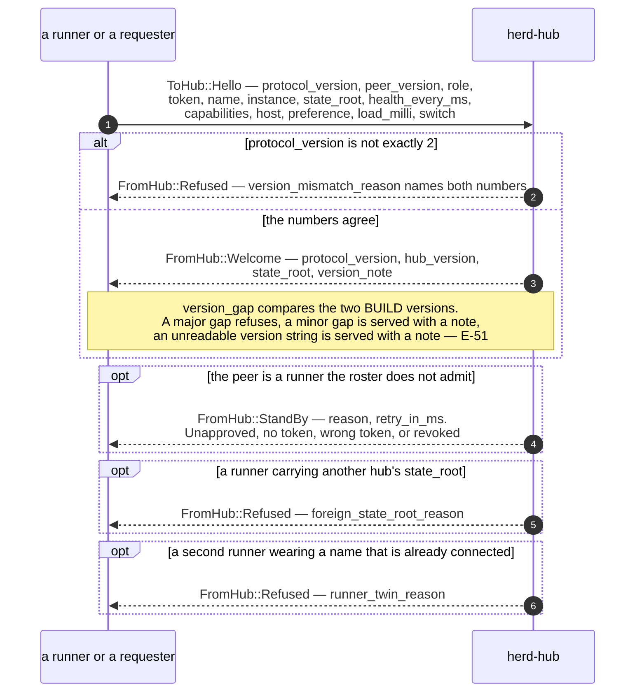

Four more refusals live in the handshake, each a named sentence in
`herd-proto` rather than a library error:

- a first frame over `MAX_FRAME_BYTES` (**1 MiB**) is read to its end and
  then refused in words, so the refusal is deliverable; past
  `FRAME_CEILING_BYTES` (**64 MiB**) the hub stops reading at all;
- a handshake that will not parse gets `unreadable_handshake_reason`;
- a requester with no token, or the wrong one, gets
  `missing_requester_token_reason` / `wrong_requester_token_reason`;
- a silence threshold shorter than `SILENCE_MARGIN` (**3**) health
  reports is refused at startup by `silence_threshold_refusal`, on both
  sides and against the cadence a runner really announces. A cadence of
  zero is refused by name.

`HEALTH_EVERY` and `STILL_THERE_EVERY` are both **15 s** — a runner says
it is alive at that cadence, and the hub speaks to a quiet follower at the
same one.

### 3.2 Every frame, both directions

Twenty-one real `ToHub` variants and twenty-nine real `FromHub` ones, plus
one catch-all arm on each. Grouped by who sends or acts on them, with the
names exactly as `herd-proto` spells them.

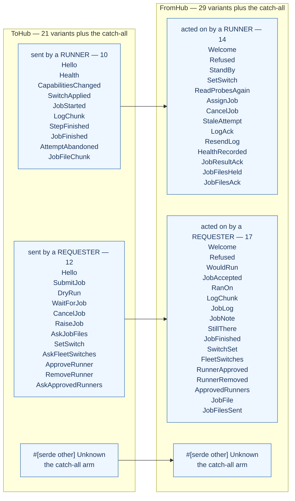

`Welcome` and `Refused` reach both kinds of peer, which is why they appear
twice. The payload types that ride inside these frames are
`Asked` (a submission), `Declaration` and `Executor`, `StepRun`,
`JobOutcome`, `JobMetrics` and `Pressure`, `JobOutputs` and `OutputFile`,
`CapabilityOffer` / `CapabilityState` / `Availability`, `HostSize`,
`RunningJob`, `RunnerSwitch`, `SwitchPersistence`, `ApprovedRunner`,
`RunnerFacts` and `SuspendedCapability`, `FileHeld` and `AbsentFile`.

`JOB_LOG_FRAME_BYTES` is **8 MiB**: a `FromHub::JobLog` backlog travels in
pieces that concatenate to exactly what one frame used to carry, which
needed no variant, no field and no version move.

### 3.3 The catch-all arm, and the three readers

Both enums carry `#[serde(other)] Unknown`, so a frame whose `type` a
build has never heard of **decodes** instead of failing to. What each of
the three readers then does is deliberately different, and the difference
is the whole value of the arm.

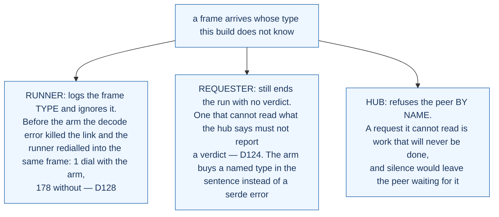

The consequence for `PROTOCOL_VERSION`, written down so it is not
re-argued: adding a `FromHub` variant a **requester** can see is still a
breaking change and still moves the number; one only a **runner** ever
sees no longer is. A new field on an existing variant may leave it alone,
and only when it is `#[serde(default)]` *and* means, when absent, exactly
what its default says.

### 3.4 The versions, and what each one refuses

Six version numbers, each refusing a different kind of mismatch — except
the last two, which refuse nothing and exist so that a consumer's parser
can tell which shape it was handed. The handshake tests **equality**, not a
floor.

| Number | Value | Where it lives | What a mismatch does |
|---|---|---|---|
| `PROTOCOL_VERSION` | **2** | `herd-proto`, in `Hello` and `Welcome` | the hub refuses the peer by name, whatever else it got right. A bump is a fleet-wide synchronised restart |
| build version (`version_gap`) | workspace `0.3.4` | `Hello::peer_version`, `Welcome::hub_version` | a major gap refuses; a minor gap is served with a note; an unreadable string is served with a note (E-51) |
| `RECORD_VERSION` | **1** | `herd-hub/src/job.rs`; sits in front of `job.json` **and every line of `events.jsonl`** | the file is not read at all: the store errors naming the path and both numbers, and because that comes out of recovery the hub **refuses to start** on that state root |
| `LAYOUT_VERSION`, `INDEX_VERSION`, `READINGS_VERSION`, `ROSTER_VERSION` | **1** each | `store.json`, `index/state.json`, `readings/answers.json`, `runners.json` | the file is refused rather than read as if it were this version; the roster's one decides who may connect |
| `OUTPUT_FORMAT_VERSION` | **1** | the `ran on: …` line a requester's stdout is framed with | nothing refuses; it is how a consumer's parser knows which framing it got (Q7) |
| `VERDICT_FORMAT_VERSION` | **1** | the first field of the JSON document `herdctl --verdict-to` writes | nothing refuses; a reader checks it before it reads anything else. Adding a field does not move it — every key is always present, so a document that gains one still answers what it answered before — while removing a field, or changing what one means, does (D166) |

`RECORD_VERSION` is frozen at 1 since M16. It reached 6 while nothing was
deployed; a bump now costs the operator's whole state root — every queued
job and every uncollected verdict — and the hub says so by not starting,
never by guessing.

## 4. A job's whole life

### 4.1 The states, with the real names from the record

`JobState` is tagged like a protocol message, so a state this Herd does
not know is a read error naming it rather than a job quietly read as
something else. Only `Finished` is terminal.

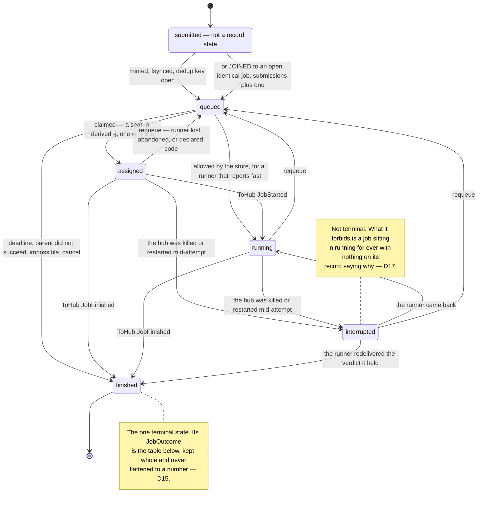

The eight outcomes, with the exit code `herdctl` wears for each:

| `JobOutcome` | `herdctl` exits | What it means |
|---|---|---|
| `Exited { code }` | **the code itself**, untouched | the job's own verdict, 0, 1, 75 or anything else — Herd never rewrites it (D20) |
| `Signalled { signal }` | **128 + n**, as a shell reports one | the process was killed by a signal |
| `StoppedByCap { cap, limit, detail }` | **124**, `timeout(1)`'s code | a runner's cap: `Cap::Time`, `Cap::Memory`, `Cap::Log` or `Cap::Disk`. `detail` is set only when the figure alone would lie |
| `CouldNotStart { reason }` | **125** | Herd could not run it at all |
| `Cancelled { reason }` | **125** | a requester asked, a deadline passed unstarted, or the parent did not succeed |
| `Lost { reason }` | **125** | a second runner loss, or the requeue budget spent |
| `Impossible { reason }` | **125** | nothing in this fleet could ever run it (E-36) |
| `SetupFailed { reason }` | **125** | it ran on a machine that could not do its own part, so nobody established anything about it. Today's one case: the runner was refused access to a path inside the job's own workspace, so the disk budget could not be enforced at all. Not a cap — 124 would tell a requester a budget killed their build — and not `CouldNotStart`, which would withhold the `ran on:` line and hide the machine whose setup is broken (D166) |

125 is one code for two opposite situations — a job that exists and may
still be running, and a submission that never left — so `herdctl` says
which on **stderr**, in one documented line, and a wrapper falls back on
that rather than on the code. A requester that would rather not parse a
sentence passes `--verdict-to <FILE>` and reads the document described in
§3.4 instead: `cause`, `exit_code_from` and `job_exists` are the three
questions the code cannot answer, in fields (D166).

Two transitions the store answers `AlreadyThere` to rather than refusing:
`finished` to `finished` with the same outcome, and `interrupted` to
`interrupted` — a record is not a journal of the hub's own restarts.
Everything else not drawn above is **refused**, naming both states, at the
store's single write entry point.

A waiting job is still `queued`: waiting is not being refused (D38), so
the reason lives in `waiting_for` beside the state and is cleared the
moment the job leaves the queue. `events.jsonl` keeps the history — one
line per `Transition`, `AttemptStarted`, `AttemptEnded`, `LogGap`,
`Joined`, `PriorityRaised`, `Waiting` and `OutputsRemoved`.

### 4.2 The two go-counts, which must never spend each other

There is **no counter anywhere**. Both budgets are read off
`JobRecord::attempts` every time they are asked, so a hub restart rebuilds
nothing and a crash mid-requeue cannot leave a budget that quietly grew
back (D79).

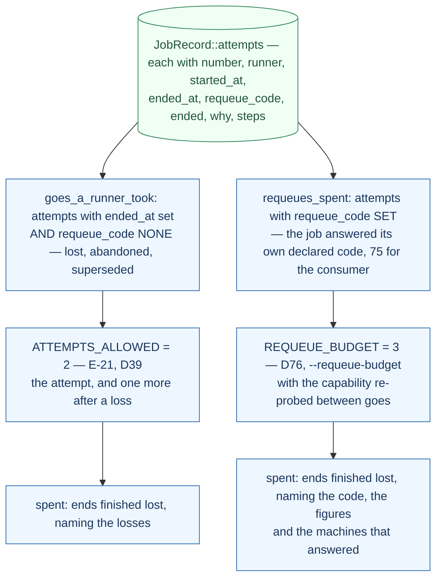

Without `Attempt::requeue_code` on the record, one leased machine
answering 75 three times would leave a job with no attempts left for the
case E-21 exists for. That field is what keeps the two apart.

An attempt is also **named, numbered and somebody's**: every job frame
carries its attempt number, a frame about an attempt from any other runner
is refused by `not_this_runner_s_attempt_reason`, and a frame about a job
that is over is refused by `a_frame_about_a_job_that_is_over_reason` —
even from the runner the attempt was handed to. `Attempt::ended_at`, not
`Attempt::ended`, is what `attempt_is_current` tests, because the attempt
that produced a verdict has nothing to excuse and so leaves `ended` unset.

## 5. The queue, and one dispatch pass

### 5.1 De-duplication, priority, ageing

**One queue holds everything** (E-20): the queue *is* the set of job
directories that have not reached a terminal state. There is no second
list and no lane for a merger — a priority is a number the order sorts on.

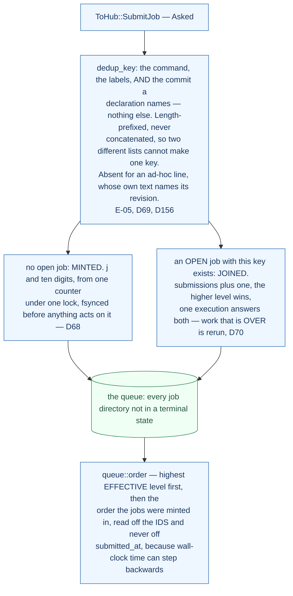

The four levels, and how ageing moves a job between them:

| Level | `rank` | Who asks for it |
|---|---|---|
| `merger` | 0 | a merge, which must start first (E-43) |
| `step` | 1 | the ordinary level; `herdctl`'s default |
| `nightly` | 2 | the scheduled pass (E-41) |
| `producer` | 3 | the cache producer (E-42) |

`queue::standing` computes the effective level as the declared one
`raised_by` one step per whole `AGING_STEP` waited, capped at the top.
`AGING_STEP` is **30 min** (`--aging-step`), so `producer` reaches the top
**90 min** after submission, which is the figure E-18's own criterion
names. **Ageing is computed, never written**: nothing ticks, nothing is
lost in a crash, and no record ever claims a level its requester did not
ask for. `JobRecord::priority` is what was asked for, raised since by an
operator's `herdctl raise` and by nothing else — and the raise is upwards
only (D72).

### 5.2 The claim step, gate by gate

`matcher::place` is a pure function of one record and the connected
runners, so a test can put a fleet in any state at all without a socket.
The order of the gates is load-bearing and is drawn in it.

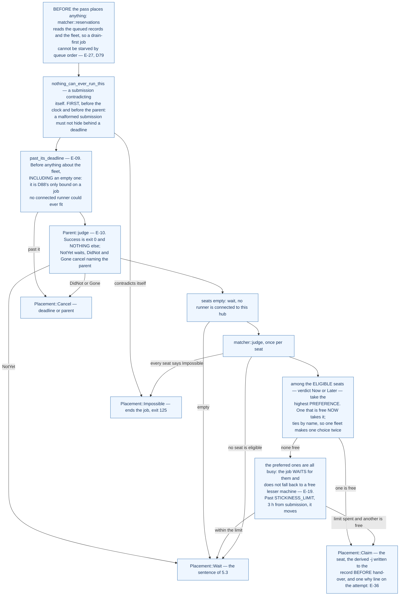

`matcher::judge` is the per-seat half, and its own order matters:

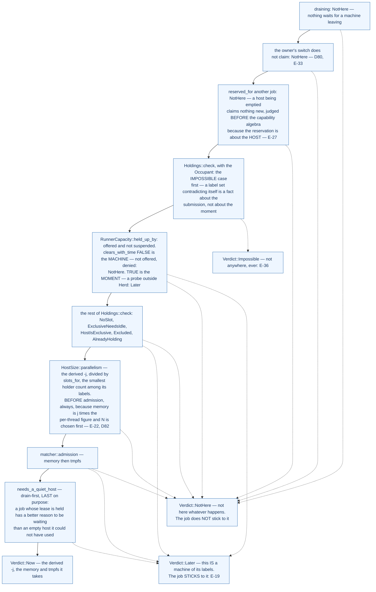

**Where the slot counts and the reservations come from: the records, every
pass, and nothing else** (D79). A job holds its labels on a runner for
exactly as long as its record says an attempt of it is open there —
`assigned`, `running` or `interrupted`, with `ended_at` unset. There is no
counter, so a leaked slot is not a bug that is hard to make; it is a state
the hub cannot represent. `matcher::holdings` and `matcher::reserved` go
through one filter, `out_there`, because two copies of that test would be
two answers to one question.

Admission weighs what jobs **declared**, never what they use: a job
admitted a second ago has allocated nothing, and M4's kernel cap is what
makes the declaration the honest unit (D87).

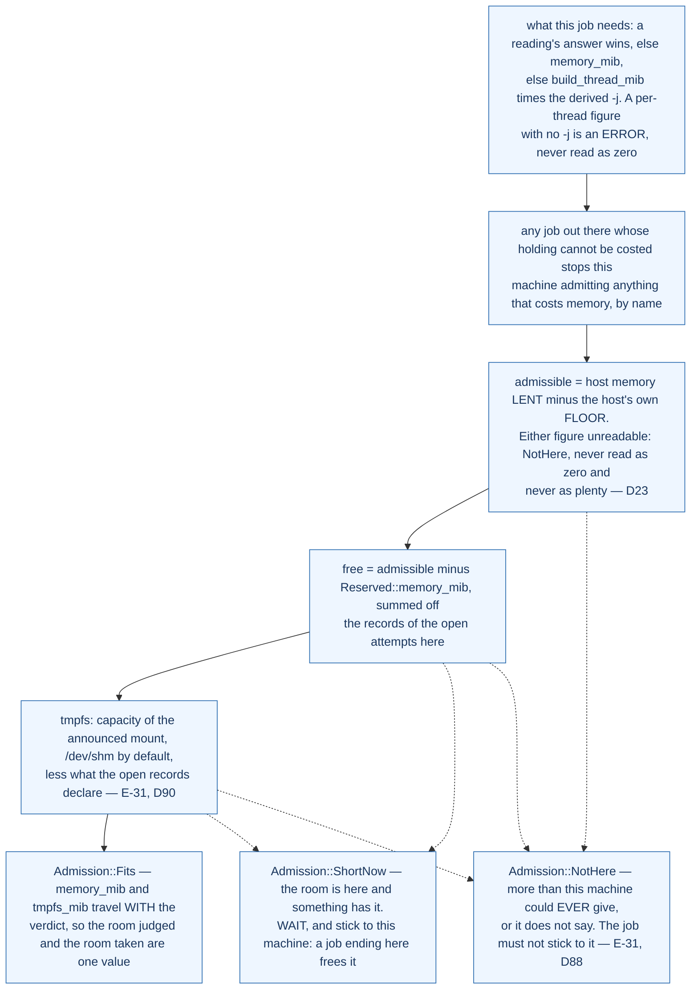

`Reserved` also counts how many of the jobs out there are requirement
readings, so a sentence can break the figure down. The host's one-minute
load reaches the hub on the handshake and every health report, lands on
the line explaining every placement, and **gates nothing** (E-32) — a test
reads the module's own source for any comparison against a load.

### 5.3 What a waiting job is told

`queue::waiting_sentence` answers three questions in one sentence — where
the job is, what it is weighed at, and when that changes — and the caller
supplies the `why` clause, because there are two different causes with two
different subjects: this job's own capabilities, or the job in front of it
that cannot start.

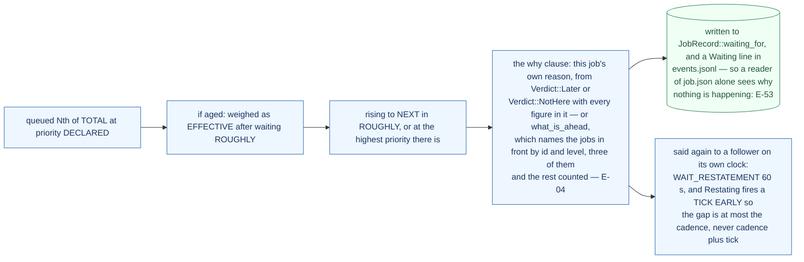

## 6. Capabilities

What a runner offers, where each offer came from, and what contends with
what. The algebra is `herd_proto::Holdings`; the hub consults it and the
runner fills it in.

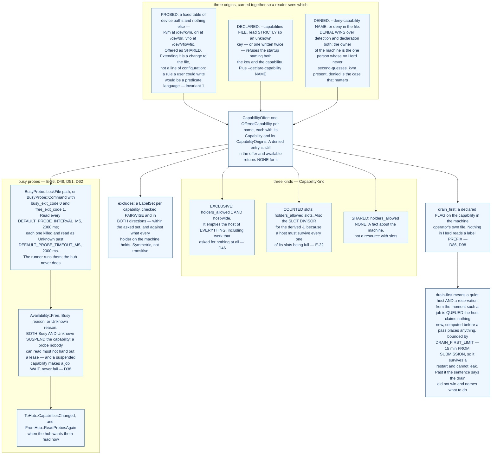

`Holdings::check` returns one of seven `Contention` values, and two
properties of each decide what the claim step does with it.

| `Contention` | `is_impossible` | `clears_with_time` | What the job gets |
|---|---|---|---|
| `NotOffered` | no | no | `NotHere` — another machine may offer it |
| `ExcludedWithin` | **yes** | no | `Impossible` — the submission contradicts itself |
| `Excluded` | no | **yes** | `Later` — a holder here holds something it excludes |
| `NoSlot` | no | **yes** | `Later` — every slot of a counted capability is taken |
| `ExclusiveNeedsIdle` | no | **yes** | `Later` — it is host-wide and this runner is not idle |
| `HostIsExclusive` | no | **yes** | `Later` — a holder here holds something host-wide |
| `AlreadyHolding` | no | no | `NotHere` — a job releases what it holds and is admitted afresh |

A label name is at most `MAX_LABEL_LENGTH` (**64**) characters, and
`LabelSet` sorts and deduplicates, so naming two labels in the other order
is the same work for the de-duplication key.
`CapabilityOffer::inert_exclusions` reports an exclusion that can never
bite — `gpu-venus excludes igpu-vfio` where `igpu-vfio` is already
exclusive and host-wide — so an operator is told rather than left
believing in it.

## 7. Requirement readings

A command may declare `labels_from` instead of static labels: a line that
prints what the job needs, run **on a machine**, because the figures depend
on the commit and on the `-j` the job was given (D74, D82). The whole
mechanism is `settle_readings` in the hub, under the lock the dispatch
pass already holds.

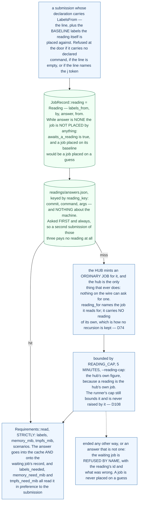

A reading is an ordinary job in every respect but one: it **holds no
capability** (D159). `JobRecord::occupant` returns `Occupant::Reading` for
it and `Occupant::Job` for everything else, read off `reading_for` in one
place so a second reading of it cannot drift. Four gates, and which side
of each a reading falls on:

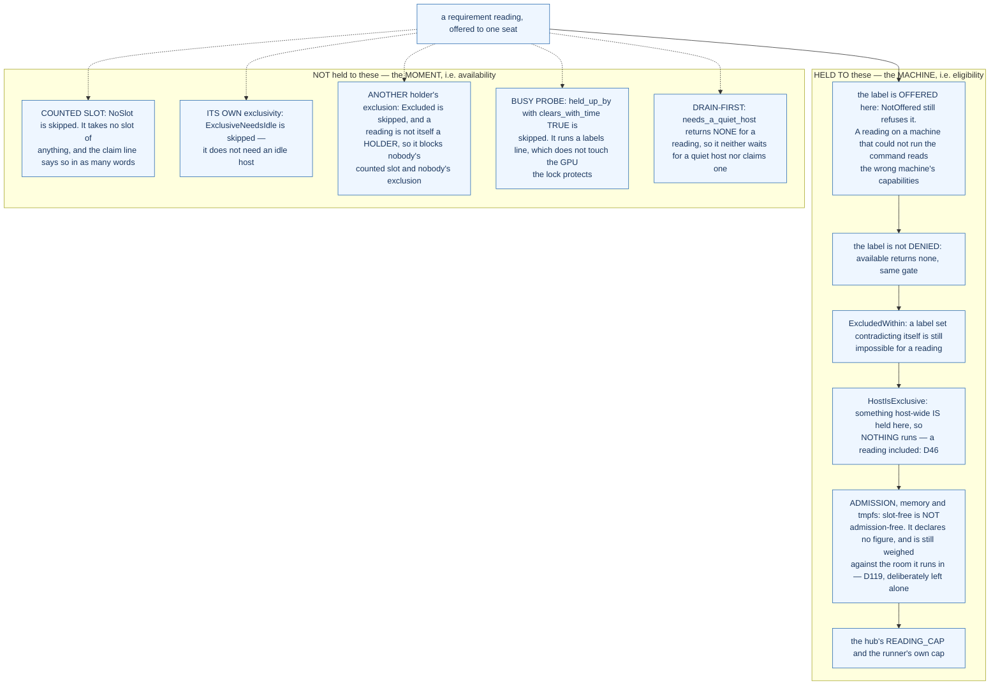

The one asymmetry worth naming, because it is easy to read the wrong way:
a reading holds nothing, but it **is** on the machine. `ExclusiveNeedsIdle`
tests `held` and not `holders`, so a running reading does stop a *new*
host-wide job from starting — and the sentences say so, through
`of_which` and `alongside`, rather than leaving an operator to wonder what
the extra job on the machine is.

The failure direction is what decides the skips. A reading that runs while
a probe says busy costs one `--labels` line on a machine something else is
using. A reading that waits for a probe nobody can read waits for ever,
and every job its answer unblocks waits behind it. The cheap mistake is
the one to make.

## 8. Confinement on the runner

`docs/runner-confinement.md` is the reference for this — the whole
configuration surface, the data root's validation, the unprivileged rules
and the helper allow-list, the three ways a runner can die, and which
assertions a host can make. What is drawn here is the shape and the knobs,
not a second copy of that document.

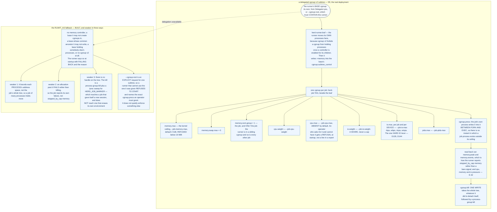

Invariant 2 holds either way: every job runs under an explicit memory cap
enforced by the kernel, and under a time cap. Beside the cgroup sit the
caps the runner enforces itself — time (`--job-timeout`, 3600 s), log
(`--job-log-cap`, 64 MiB), disk (`--job-disk-budget`, 20 GiB) and output
(`--job-output-cap`) — each ending the job `stopped_by_cap` naming the cap
and its figure, for which `herdctl` exits **124**. A breached cap
**outranks the job's own exit status**: the runner checks the caps once
more after the process is gone, and the cap wins, because a truncated
build reported green is the worst thing a build service can do.

### 8.1 The environment a job inherits

Built from scratch, never inherited, so nothing in the runner's own
environment — a hub token, a `TMPDIR` on the host's disk — can reach a job
or redirect its writes.

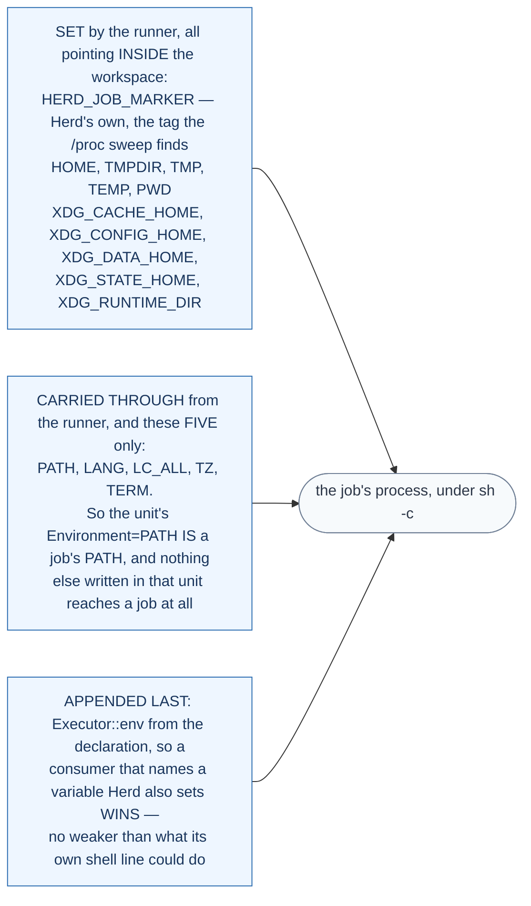

### 8.2 The executor's four steps, and the token substitutions

Four named steps, one fixed order, no conditions, no branching, and no
step a declaration can add: the day a step gains a condition, Herd has
grown the workflow language invariant 1 refuses to be (D77). Each hook is
handed to `/bin/sh -c` **whole** and never split into an argv Herd
invented (D107).

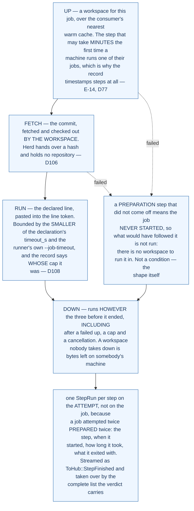

Seven tokens, and three fillers — each the one place that knows the value.
A declaration carrying a token nobody fills is refused by name rather than
run with a brace in it.

| Token | Filled by | Because |
|---|---|---|
| `{args}` | `herdctl`, **before the job is minted** | the requester typed them, and `shell_quote`'s quoting makes them one line. Before the mint, so the record's command is the line that will run and the de-duplication key sees two different argument lists as two jobs |
| `{commit}` | `herdctl`, before the mint | resolved in the requester's own checkout (D106) |
| `{j}` | the **hub** | it is a property of the machine the hub chose, derived as it chooses one, and written to the record before hand-over (E-22, D82). It is held out of the requester's own arguments by `filled_outside_the_arguments`, so an argument that says `{j}` is not turned into a thread count (D107, D139) |
| `{job}`, `{in}`, `{out}` | the **runner** | the id is the hub's but the directories are the runner's own |
| `{line}` | the **runner** | the declared line pasted into the `run` hook, as text; `{job}`, `{in}` and `{out}` inside it are filled first, and never over the text a requester's arguments put there |

## 9. Outputs: two carriages, one collection

A job's output is a **record**, read next by a requester, so it travels
through the hub — unlike a pack, read next by a job, which must not (D10,
D148). A requester declares nothing about size: the runner measures the
collection when the job ends and chooses, at the only moment when
everything is weighed and nothing is read.

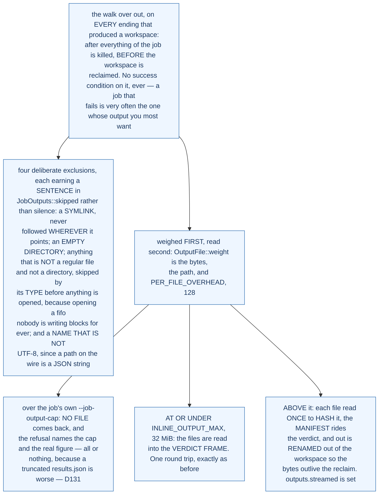

The streamed carriage, end to end:

```mermaid
sequenceDiagram
  autonumber
  participant Job as the job's processes
  participant Runner as herd-runner
  participant Hub as herd-hub
  participant Disk as the hub's job directory
  participant Ctl as herdctl

  Job->>Runner: writes under out, then exits
  Runner->>Runner: walk, weigh, hash each file once, then rename out<br/>into the spool so the bytes outlive the reclaim
  Runner->>Hub: ToHub::JobFinished — outcome, metrics, steps, and the<br/>MANIFEST of path, len and sha256 per file, streamed true
  Hub->>Disk: the record, atomically, with the manifest in outputs.files
  Hub-->>Ctl: FromHub::JobFinished — the VERDICT GOES FIRST, so a side<br/>channel never delays it and a stop still takes 5 s or less
  Hub-->>Runner: FromHub::JobResultAck — only once it is RECORDED
  loop file by file, OUTPUT_CHUNK_BYTES is 1 MiB a chunk
    Runner->>Hub: ToHub::JobFileChunk — job_id, attempt, path, OFFSET, data
    Hub->>Disk: appended into files.part/PATH
    Note over Runner: a PERMIT out of the link's window, FILES_IN_FLIGHT is 8.<br/>Returned only once the chunk is really ON THE WIRE — D158.<br/>A pump that waits FILES_STALL_AFTER, 15 s, says so on stderr
  end
  Hub->>Disk: on a file's last byte — VERIFY the sha256, then rename<br/>files.part/PATH into files/PATH. ChunkLanded is More,<br/>Complete or Refused, and a bad offset, an unannounced path<br/>or a digest that did not match is NAMED, never retried quietly
  Hub-->>Runner: FromHub::JobFilesAck — whole, so the spool may be dropped
  Ctl->>Hub: ToHub::AskJobFiles — only the paths it is still MISSING
  Hub-->>Ctl: FromHub::JobFile chunks, then FromHub::JobFilesSent,<br/>whose absent entries carry path, len, why, held, still_coming
```

What resumption means on each leg, and they are different:

- **Runner to hub.** The runner holds the collection in its own data root
  until the hub acknowledges all of it. On every redial the hub scans its
  job directories (`collections_owed`) and sends
  `FromHub::JobFilesHeld` — which files it holds complete, and how many
  bytes of a partial one — so the runner resumes at the right offset. A
  fresh link starts with a full window, because the chunks queued on the
  link that broke went with it and so did their permits.
- **Hub to requester.** There is **no transfer state to recover**: the
  bytes are on the hub's disk, so a requester simply asks again with a
  shorter list. `herdctl` waits while a collection is still *moving* —
  unbounded on purpose, because a few hundred megabytes on a slow link is
  slow and not broken — and stops after `OUTPUTS_STALL_LIMIT`, **30 s**,
  of no progress, polling every **200 ms**.

And the budget, which is why streaming could ship at all: a sweeper with
no budget is a disk-full outage with a delay fuse (D152).

```mermaid
flowchart TB
  classDef built fill:#eef6ff,stroke:#2b6cb0,stroke-width:1px,color:#1a365d
  classDef unbuilt fill:#fff7ed,stroke:#c05621,stroke-width:1px,stroke-dasharray: 6 4,color:#7b341e
  classDef store fill:#f0fff4,stroke:#2f855a,stroke-width:1px,color:#22543d
  classDef outside fill:#f7fafc,stroke:#718096,stroke-width:1px,color:#2d3748

  B["TWO figures and no third: --output-budget, 200 GB, and<br/>--output-floor, 7 days, both printed at startup.<br/>No tier, no class, no per-job override — invariant 1"]
  WALK["the sweep walks jobs/STAR/files and NOTHING ELSE. A hub<br/>INSIDE its budget reads NO RECORDS AT ALL: it measures,<br/>finds nothing to do, writes the figure down and stops"]
  O1["1. OUTSIDE the floor before INSIDE it. Seven days is a<br/>promise, so nothing inside goes while anything outside remains"]
  O2["2. a job that PASSED before a job that DID NOT. The<br/>artefacts of a green run are the ones nobody ever opens"]
  O3["3. FETCHED before NEVER FETCHED — where the obvious cache<br/>answer is BACKWARDS. An LRU evicts what nothing touched;<br/>here a collection nobody fetched is evidence NOBODY HAS SEEN"]
  O4["4. OLDEST FIRST, and only as the TIE-BREAK. Alone it would<br/>delete last week's one red test to keep this morning's<br/>thousand green ones"]
  NEVER["never a candidate, under any of them: a collection still<br/>ARRIVING. Its bytes are the writer's. The collection that<br/>TRIGGERED the sweep is a candidate once whole, and is the LAST<br/>of its rank — so a budget smaller than one collection takes<br/>it back the moment it completes, records why, and says so"]
  EV["evict: measure, rename files/ to files.gone/, put files/<br/>back EMPTY so the directory has the shape it always had,<br/>write OutputsRemoved — at, why with the figures, bytes — and<br/>an OutputsRemoved event, THEN remove the tree"]
  MAN["THE MANIFEST OUTLIVES THE BYTES. KeptFile keeps path, bytes<br/>and sha256 for as long as the record does — kilobytes however<br/>many hundreds of megabytes they describe, so there is never a<br/>reason to delete them. A requester asking for an evicted<br/>collection is handed that sentence, with its date and its<br/>budget, instead of a short directory it would read as whole"]
  CNF["could_not_free: a record that will not read, one not<br/>terminal, one already removed, or a collection not yet whole.<br/>A record that will not read is a LOUDER problem than this and<br/>is NOT a licence to delete the files it describes"]

  B --> WALK --> O1 --> O2 --> O3 --> O4 --> EV --> MAN
  WALK --> NEVER
  WALK --> CNF

  class B,WALK,O1,O2,O3,O4,NEVER,EV,MAN,CNF built
```

## 10. Storage on disk

Two roots, plain files, and exactly one write discipline.

```mermaid
flowchart TB
  classDef built fill:#eef6ff,stroke:#2b6cb0,stroke-width:1px,color:#1a365d
  classDef unbuilt fill:#fff7ed,stroke:#c05621,stroke-width:1px,stroke-dasharray: 6 4,color:#7b341e
  classDef store fill:#f0fff4,stroke:#2f855a,stroke-width:1px,color:#22543d
  classDef outside fill:#f7fafc,stroke:#718096,stroke-width:1px,color:#2d3748

  subgraph HUBROOT["the hub's STATE ROOT — --state-dir, /var/lib/herd — D8"]
    SJ[("store.json — LAYOUT_VERSION and this root's own IDENTITY,<br/>rewritten at every start. A runner carrying another root's<br/>identity is refused: a job id means something only inside<br/>one hub's state")]
    HL[("hub.lock — flock(2). ONE hub per root, and a lock the<br/>kernel drops even when the hub is killed — D21")]
    RJ[("runners.json — ROSTER_VERSION, one entry per approved<br/>runner: the name, when, a 16-byte SALT, and<br/>sha256(salt and token). The TOKEN ITSELF is never written<br/>anywhere, so a leaked state root leaks no credential.<br/>An EMPTY roster refuses every runner — E-48, Q8")]
    IX[("index/state.json — DERIVED: which jobs are not over yet.<br/>It exists so starting does not parse the whole history, and<br/>the hub CHECKS it rather than believing it")]
    RD[("readings/answers.json — DERIVED: what every labels_from<br/>reading answered, by commit, command and args — D74")]
    subgraph JD["jobs/jNNNNNNNNNN/ — one directory per job, the ONLY truth"]
      JJ[("job.json — the record: every field, the current state,<br/>the timestamps, the attempts, the metrics, the manifest")]
      EJ[("events.jsonl — one line per thing that happened, IN ORDER.<br/>The ORDER OF THE LINES is a job's history, never a<br/>comparison of timestamps, which can step backwards")]
      LG[("log — both streams in ARRIVAL ORDER, byte for byte. It<br/>does not promise per-stream exactness, by choice: a build log<br/>is read as a terminal transcript — D29")]
      LS[("log.seq — how many chunks have been written and how many<br/>bytes they are, FIXED WIDTH and written IN PLACE")]
      FD[("files/ — the bytes a job kept. Has existed, and been<br/>empty, in every job directory since M2")]
      FP[("files.part/ — a streamed file being appended to, until its<br/>digest verifies and it is renamed into files/")]
      FG[("files.gone/ — an eviction in flight; a hub that stopped<br/>mid-eviction leaves one, and the next sweep removes it")]
    end
  end

  subgraph DATAROOT["a runner's DATA ROOT — --data-root — E-45"]
    DL[(".herd-runner.lock — ONE runner per data root, refusing to<br/>start and naming the other runner's pid. Dies with the<br/>process, so a killed runner leaves the root free")]
    HSR[("hub-state-root — which hub's state this runner belongs to")]
    HR2[("held-results/JOB.json — a verdict the hub never<br/>acknowledged, written VERBATIM and FSYNCED on the way out.<br/>DELIBERATELY OUTSIDE jobs/, so the startup reaper cannot<br/>clear it — D34")]
    subgraph WS["jobs/JOB/ — one workspace"]
      WW[("work — the job's working directory")]
      WH[("home — its HOME")]
      WT[("tmp — its TMPDIR, TMP, TEMP and XDG_RUNTIME_DIR")]
      WI[("in — a DECLARED command's in token. Made before up runs,<br/>and EMPTY: what fills it is M11's pack half")]
      WO[("out — its out token, where it leaves what it keeps")]
    end
  end

  DISC["durable.rs — the ONE place in Herd that writes to a filesystem.<br/>Nothing calls fs::write on its own.<br/>REPLACE: write a temporary BESIDE the destination, fsync the<br/>TEMPORARY, rename it over, fsync the DIRECTORY. Rename is<br/>atomic, so a reader sees the WHOLE old file or the WHOLE new<br/>one — never half of either, which is what E-53 and E-54 need.<br/>A FAILED write is a write that did not happen: the<br/>destination keeps what it had and no temporary is left.<br/>APPEND: one line as one write, on the disk before returning.<br/>IN PLACE: only for a fixed-width file, log.seq"]

  DISC --> SJ
  DISC --> RJ
  DISC --> IX
  DISC --> RD
  DISC --> JJ
  DISC --> EJ
  DISC --> LG
  DISC --> LS
  DISC --> FD

  class SJ,HL,RJ,IX,RD,JJ,EJ,LG,LS,FD,FP,FG,DL,HSR,HR2,WW,WH,WT,WI,WO store
  class DISC built
```

One honest limit, stated plainly: a job that names an **absolute path
outside** its root is not stopped. That needs a mount namespace, which
E-46 forbids on this runner, so confinement here is cooperative (D28). The
declared command contract is where a job stops choosing its own paths.

An ad-hoc job gets `work`, `home` and `tmp` and nothing else; `in` and
`out` are made only for a declared command, before its `up` step runs.

## 11. The real deployment

### 11.1 What runs where

```mermaid
flowchart TB
  classDef built fill:#eef6ff,stroke:#2b6cb0,stroke-width:1px,color:#1a365d
  classDef unbuilt fill:#fff7ed,stroke:#c05621,stroke-width:1px,stroke-dasharray: 6 4,color:#7b341e
  classDef store fill:#f0fff4,stroke:#2f855a,stroke-width:1px,color:#22543d
  classDef outside fill:#f7fafc,stroke:#718096,stroke-width:1px,color:#2d3748

  subgraph SERVER["the NixOS server — 31 GiB, 12 threads, NO SWAP"]
    subgraph DC["docker compose, project herd, at /srv/herd — D5"]
      IMG["image HERD_HUB_IMAGE from .env, ALWAYS WITH ITS VERSION.<br/>There is no latest and none is published: a floating tag is<br/>how a hub restarts into a different PROTOCOL_VERSION by<br/>accident, and that is a fleet-wide synchronised restart"]
      HUBC["the hub: HERD_LISTEN 0.0.0.0:8787 INSIDE ITS NAMESPACE,<br/>read_only root, tmpfs /tmp, cap_drop ALL,<br/>no-new-privileges, mem_limit 2g and memswap_limit 2g so it<br/>cannot swap, stop_grace_period 20s, json-file logging capped<br/>at 20m times 5 so the hub's own logs can never fill the NVMe"]
      PORTS["ports: 127.0.0.1:8787:8787 — LOOPBACK ONLY, so no port is<br/>ever opened on a router. docker-compose.traefik.yml is an<br/>OVERRIDE that joins the proxy's network and KEEPS this line,<br/>because this host's runner and herdctl both dial loopback"]
      VOL[("volume herd-state on /var/lib/herd — EXACTLY that path,<br/>because the image creates it and gives it to the hub's own<br/>uid 1000, and docker seeds a fresh named volume from the<br/>directory it mounts over")]
      SEC[("compose secret from HERD_REQUESTER_TOKEN_FILE on the HOST:<br/>/etc/herd/requester-token, mode 0444 inside a 0700 directory.<br/>uid, gid and mode on a compose secret are SILENTLY IGNORED<br/>outside swarm, so the HOST file's mode is what the hub reads.<br/>What keeps it private is the DIRECTORY, not the file")]
    end
    subgraph UNIT["systemd: herd-runner.service, NATIVE and unprivileged"]
      WHY["NOT a container, because it needs /dev/kvm, /dev/dri,<br/>/dev/vfio and the consumer's own mount namespaces — E-47.<br/>User=herd, NOT in the docker group and never needing to<br/>be — D78. SupplementaryGroups=kvm render video"]
      DELU["Delegate=yes — THE POINT OF THE UNIT, not a detail:<br/>systemd chowns this unit's cgroup directory, cgroup.procs<br/>and cgroup.subtree_control to User=.<br/>--cgroup-root is given anyway, redundantly, because an<br/>ABSENT root falls back LOUDLY while an EXPLICIT one that<br/>cannot be used REFUSES the startup — D33"]
      OOM["OOMPolicy=continue — a job reaching its own memory.max is a<br/>cgroup OOM kill under this unit, and the default would take<br/>the runner down with the job"]
      OUTER["MemoryMax=22G, MemorySwapMax=0, CPUWeight=50, IOWeight=50.<br/>The runner READS the enclosing memory.max at startup, takes<br/>the TIGHTEST it finds walking up, subtracts what is charged,<br/>and announces THAT instead of MemTotal when it is lower — D119"]
      FLAGS["--hub ws://127.0.0.1:8787, --name server,<br/>--data-root /mnt/ssd_980/herd-runner, --job-memory-max 8GiB,<br/>--job-timeout 5400, --job-log-cap 64MiB,<br/>--job-disk-budget 20GiB, --job-nice 10, --host-memory 20GiB,<br/>--host-memory-floor 6GiB, --host-threads 8,<br/>--host-tmpfs 4GiB, --host-tmpfs-path /dev/shm,<br/>--health-every 15, --drain-grace 3"]
      TOK[("EnvironmentFile=-/etc/herd/runner-token.env, mode 0400,<br/>owned by herd. systemd reads it as ROOT before dropping to<br/>User=, so this one never needs opening up. The leading dash<br/>lets the unit start WITHOUT it, so the refusal comes from the<br/>HUB by name rather than from systemd")]
      DISKWHY["--data-root is on the EXT4 NVMe and not /var/lib, because<br/>an io.weight reaches a block device and reaches NOTHING on<br/>the ZFS pool that carries / and /nix/store — D120, D126, D144"]
      KM["KillMode=mixed, KillSignal=SIGTERM, TimeoutStopSec=10:<br/>the default control-group mode would SIGTERM the running jobs<br/>BEHIND THE RUNNER'S BACK, and a drain is the runner ending<br/>them itself and reporting it. Restart=always, RestartSec=5s —<br/>back after a crash and after a reboot: E-52"]
      NIX["TWO ways to carry this unit, and a machine is on EXACTLY<br/>one: this FILE copied into /etc/systemd/system with every<br/>OWNER note done by hand, or deploy/nixos-herd-runner.nix<br/>IMPORTED from /etc/nixos — which is what the server runs,<br/>at tag v0.2.0. The generation holds the store path, so no<br/>garbage collection can take it. The two must be changed<br/>TOGETHER. Herd never writes in /etc/nixos"]
    end
    PRX(["the operator's reverse proxy — nginx or traefik, configs in<br/>deploy/reverse-proxy/. It TERMINATES TLS; the hub never<br/>wraps its listener — D4, D14"])
    CF(["Cloudflare in front of the proxy, which is why the only<br/>wss:// dial Herd would ever make is to a PUBLICLY TRUSTED<br/>certificate — and why there is no trust-this-CA option: D115"])
  end

  subgraph PCBOX["the owner's Windows PC — M17, PREPARED and NOT JOINED"]
    WSL["UNBUILT as a joined machine: herd-runner inside WSL2 — D145.<br/>A systemd USER unit with Delegate=yes, started by a Windows<br/>LOGON TASK, with her own switch file and a desktop shortcut.<br/>deploy/capabilities-wsl-pc.json declares ONE build slot and<br/>no kvm. deploy/wsl2-check.sh is the verification script the<br/>runbook stops after.<br/>THE LOAD-BEARING UNKNOWN: whether a user scope on that WSL2<br/>gets a delegated subtree with MEMORY in it — D149"]
    WSLMEM["UNBUILT: WSL2's OWN memory limit, in .wslconfig, is a<br/>DIFFERENT and HIGHER ceiling than Herd's per-job one"]
  end

  AGENTS(["requesters: the consumer's AI agents, their merger and their<br/>nightly task, all through herdctl with HERD_TOKEN"])

  AGENTS -->|"ws://127.0.0.1:8787"| PORTS
  UNIT -->|"ws://127.0.0.1:8787 — plain ws over loopback crosses no<br/>network and needs no TLS"| PORTS
  PORTS --> HUBC
  IMG --> HUBC
  HUBC --- VOL
  HUBC --- SEC
  PRX --> PORTS
  CF --> PRX
  WSL -.->|"UNBUILT: wss:// through Cloudflare, or plain ws:// on the<br/>TAILNET at 100.x.y.z:8787, which needs the compose publish<br/>moved off loopback onto the mesh address — ONE LINE — D11"| CF

  class IMG,HUBC,PORTS,WHY,DELU,OOM,OUTER,FLAGS,DISKWHY,KM,NIX built
  class WSL,WSLMEM unbuilt
  class VOL,SEC,TOK store
  class PRX,CF,AGENTS outside
```

No secret is in the repository (invariant 7). Both token files live in
`/etc/herd`, which is `0700` and root's, and `deploy/env.example` carries
only *paths*. The requester token is **one shared token**, so any
requester that has it may ask for the `merger` level: there is no
authentication ceiling per requester yet.

### 11.2 The release and CD path

`ci.yml` is the merge gate and nothing else is: job `check` — flake check,
`fmt`, `clippy`, the suite, with `scripts/report-skips.sh` turning each
`HERD-SKIPPED:` line into a warning on the run and into its summary — and
job `docs`, which is `scripts/check-docs.sh`.

```mermaid
flowchart TB
  classDef built fill:#eef6ff,stroke:#2b6cb0,stroke-width:1px,color:#1a365d
  classDef unbuilt fill:#fff7ed,stroke:#c05621,stroke-width:1px,stroke-dasharray: 6 4,color:#7b341e
  classDef store fill:#f0fff4,stroke:#2f855a,stroke-width:1px,color:#22543d
  classDef outside fill:#f7fafc,stroke:#718096,stroke-width:1px,color:#2d3748

  TAG["a pushed tag vSTAR — or a hand-run, which builds and verifies<br/>everything and publishes NOTHING"]
  VER["the version comes from Cargo.toml's workspace.package.version,<br/>READ THROUGH THE FLAKE, so it cannot be a number somebody<br/>typed here. A tag that is not vVERSION or a pre-release of it<br/>FAILS the run"]
  PRE["BEFORE ANYTHING IS BUILT: the Docker Hub credentials are<br/>checked BY NAME — the DOCKERHUB_USERNAME repository VARIABLE<br/>and the DOCKERHUB_TOKEN repository SECRET, each told which<br/>settings tab it lives in. The cheapest way to never have a<br/>half-release is to refuse the run while nothing is done — D153"]
  STATIC["nix build .#static — three binaries, STATIC against musl<br/>out of nixpkgs' own cross set, so no toolchain is installed"]
  ASSERT["FOUR assertions that each catch a different way of getting it<br/>wrong: file(1) says static, ldd(1) finds no loader, readelf<br/>finds NO PT_INTERP segment, and no /nix/store path appears<br/>anywhere in the bytes"]
  SMOKE["run on ARCH LINUX, which is glibc, and on ALPINE, which is<br/>musl — neither has ever had Nix. A hub, a runner and TWO<br/>REAL JOBS through scripts/release-smoke.sh, as uid 1000,<br/>because a runner refuses to start as root"]
  SUMS["name them with the version and the triple, and sum them.<br/>SHA256SUMS must cover EXACTLY THREE files — the first release<br/>this workflow cut shipped two of three, because herdctl has<br/>no hyphen"]
  ART["uploaded as a run artifact on EVERY run, tag or not"]
  IMAGE["nix build .#hub-image, from nix/hub-image.nix and NOWHERE<br/>ELSE: there is no Dockerfile and no second way to build the<br/>hub, because two ways is how the thing DEPLOYED stops being<br/>the thing TESTED"]
  TAGS["assert the archive carries herd-hub:VERSION and ONLY that"]
  ISMOKE["scripts/image-smoke.sh: a hub OUT OF THE IMAGE, in exactly<br/>the shape compose gives it — read-only root, a volume on<br/>/var/lib/herd, the image's own non-root user — with the<br/>static runner and herdctl dialling it, and two real jobs.<br/>Needs NO credentials, so the image half runs on a hand-run"]
  PUSH["UNBUILT IN PRACTICE: skopeo copy STRAIGHT FROM THE ARCHIVE<br/>to docker.io. Written, reviewed and ordered BEFORE the GitHub<br/>release so a tag never leaves binaries published and an image<br/>missing. It has NEVER RUN: the account, the variable and the<br/>repository-scoped token do not exist yet, so the credential<br/>check above refuses every tag that reaches it"]
  PULL["UNBUILT IN PRACTICE: pull it back BY DIGEST — a tag is a name<br/>somebody can move, a digest is the bytes — and run a hub out<br/>of THAT. The only step that proves what is on Docker Hub"]
  REL["UNBUILT IN PRACTICE: gh release create, with<br/>deploy/release-notice.md QUOTED into the body and linked, and<br/>a suffixed tag published as a PRE-RELEASE"]
  LOCAL["so the deployment path that really works today:<br/>nix build .#hub-image and docker load on the server, giving a<br/>purely LOCAL tag that .env names. deploy/README.md documents<br/>it; it is no longer meant to be the normal way"]

  TAG --> VER --> PRE --> STATIC --> ASSERT --> SMOKE --> SUMS --> ART
  ART --> IMAGE --> TAGS --> ISMOKE
  ISMOKE -.-> PUSH -.-> PULL -.-> REL
  ISMOKE --> LOCAL

  class TAG,VER,PRE,STATIC,ASSERT,SMOKE,SUMS,ART,IMAGE,TAGS,ISMOKE,LOCAL built
  class PUSH,PULL,REL unbuilt
```

## 12. What is drawn and not built

Every dashed box above, collected, so a reviewer can check the list
against the diagrams rather than hunting for them. Each line says where
the gap is recorded.

| Not built | Where it is drawn | Recorded |
|---|---|---|
| **The `wss://` dial.** The code compiles it, both dialling crates carry rustls and the webpki roots, `deploy/README.md` has the walk that would prove it — and **no `wss://` dial has ever happened**. The tailnet makes it optional | §1, §11.1 | `status.md` "not done" 4; D115; `docs/joining.md` "Picking ws or wss" |
| **The reaper's janitor list.** The startup reaper removes workspaces, cgroups and stray processes and names each on stderr; the **durable file outside `jobs/`**, which a consumer's janitor would read, does not exist. So a failing `up` still leaves out-of-workspace state behind | §8 by its absence — there is no node for it | D134; `status.md` "not done" 1 |
| **M12's locality**, and all of M12: placement preference for a runner already holding a key (E-23), pack custody and keepers, per-runner budgets and gc with pinning (E-16), and the record's own 14/90-day retention (E-15's half) | §5.2 — preference is a declared integer per machine and nothing orders by keys held | `docs/plan.md` M12 |
| **The Docker Hub push**, the pull-back by digest and the GitHub release. All three are written and ordered; none has ever run, for want of an account, a repository variable and a scoped token | §11.2 | D153; `status.md` "Next action" |
| **M11's pack half.** There are **no registry frames** on either enum, no content-addressed store under a data root, no mesh-bound fetch endpoint, no same-host hardlink or reflink path, no keeper, no scoped fetch capability. `{in}` is made and left empty | §1 and §10 | D10, D11; `docs/plan.md` M11; `herd-runner/src/lib.rs` says the endpoint "arrives in M11" |
| **A per-requester authentication ceiling.** One shared requester token, so any requester holding it may ask for `merger` | §11.1 | `status.md` "not done" 4 |
| **M13's status document** (E-35, E-37), **M14's scheduled jobs and push hook** (E-41, E-42), **M15d's self-update**, **M18's acceptance** | not drawn — nothing of them exists to draw | `docs/plan.md` |

Three things that are built and are **weaker than the picture might
suggest**, which a reviewer should not read as gaps:

- the **`RLIMIT_AS` fallback** (§8) is a real kernel cap and is weaker in
  three named ways; which one a host got is in the runner's startup report;
- **confinement is cooperative** (§10): a job naming an absolute path
  outside its data root is not stopped, and that needs a mount namespace
  E-46 forbids (D28);
- the hub **re-reads every job record** on each 200 ms poll of a waiting
  `--outputs-to`: invisible at today's job count, about 0.9 s of hub time
  per poll at 100 000 records (D152).
